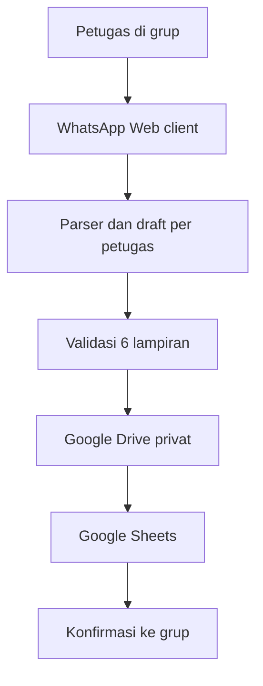
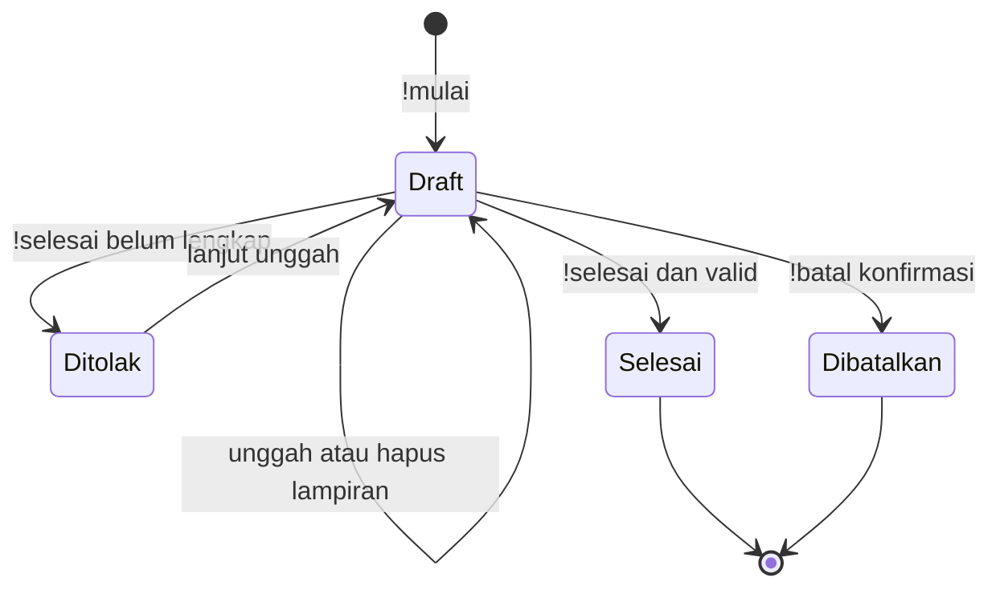

# Arsitektur Snap2Sheet Automation

## Keputusan utama

| Area | Keputusan |
| --- | --- |
| Sumber pesan | Grup WhatsApp biasa melalui sesi WhatsApp Web |
| Isolasi laporan | Satu draft aktif per kombinasi grup dan petugas |
| Klasifikasi lampiran | Caption wajib `#ba`, `#iso`, `#dok1`–`#dok4` |
| Penyimpanan file | Folder privat Google Drive per tanggal dan submission |
| Penyimpanan tabular | Append satu baris Google Sheets setelah validasi lengkap |
| Idempotensi | ID pesan WhatsApp dicatat; duplikasi noreg diperiksa lokal dan di Sheets |
| Recovery | Draft dan message ID disimpan atomik pada persistent volume |

## Aliran data

Lampiran langsung diunggah ke Drive saat diterima. Sheets belum diubah sampai `!selesai` berhasil. Jika draft dibatalkan, foldernya dipindahkan ke Trash Drive sehingga masih dapat dipulihkan oleh administrator.

## State machine

## Batas keandalan

`whatsapp-web.js` mengendalikan sesi WhatsApp Web dan bukan API resmi Meta. Perubahan internal WhatsApp dapat memutus client atau meminta pemindaian QR ulang. Karena itu:

1. Gunakan nomor khusus operasional.
2. Simpan direktori autentikasi pada volume persisten.
3. Hindari broadcast, spam, dan pengiriman pesan di luar balasan workflow.
4. Pantau endpoint `/healthz` dan log `disconnected`/`auth_failure`.
5. Siapkan migrasi ke Groups API resmi jika organisasi memperoleh Official Business Account dan bersedia membuat grup melalui API.

## Privasi

- Tautan Drive tidak diubah menjadi public/anyone-with-link.
- Hak akses mengikuti folder induk Drive.
- Credential dan state lokal tidak dicatat ke Git.
- Google Sheets ditulis memakai mode `RAW`, sehingga teks pelanggan tidak dieksekusi sebagai formula.
- Batasi `BOT_ALLOWED_SENDERS` setelah daftar nomor petugas diketahui.
